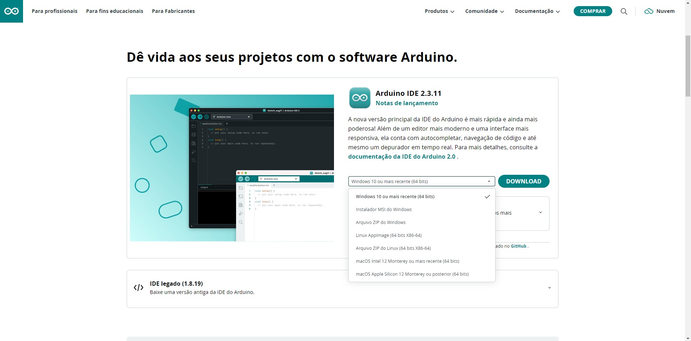
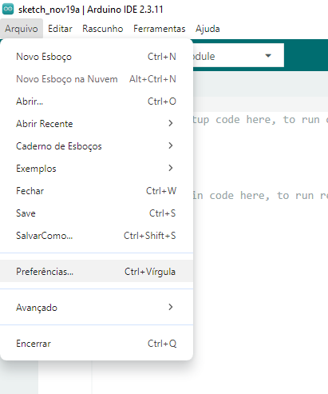
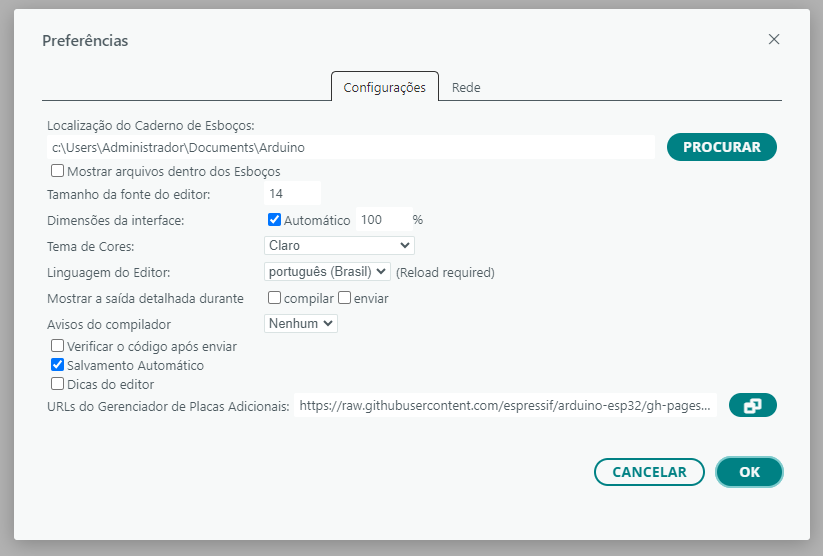
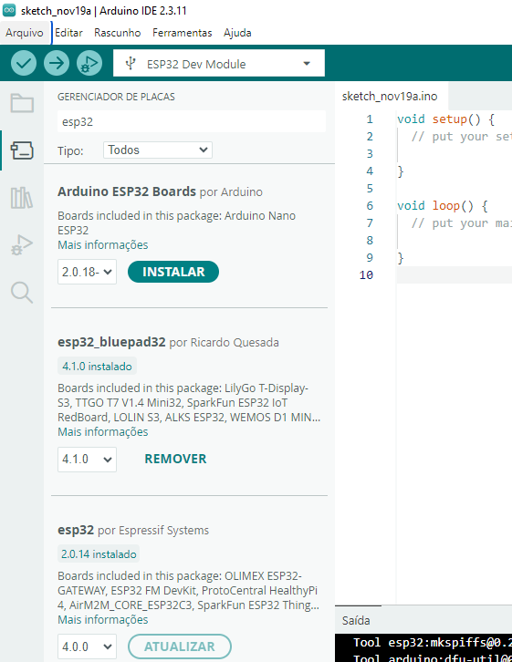

# ⚙️ Configuração do Ambiente de Desenvolvimento (Arduino IDE + ESP32)

Este guia apresenta o passo a passo completo para instalar a **Arduino IDE** e configurá-la para programar os microcontroladores **ESP32** utilizados na telemetria, célula de carga e sistemas de solo da **FALCON-6 Rocket Design**.

---

## 1. Download e Instalação da Arduino IDE

1. Acesse a página oficial de downloads da Arduino:
   👉 **[https://www.arduino.cc/en/software/](https://www.arduino.cc/en/software/)**

2. Na seção **Arduino IDE**, selecione o instalador correspondente ao seu sistema operacional (Windows, Linux ou macOS) e clique em **DOWNLOAD** *(clique em "Just Download" na tela seguinte caso não deseje contribuir financeiramente no momento)*:

   

3. Execute o instalador baixado e conclua a instalação mantendo as opções padrão (aceite a instalação de drivers USB caso solicitado).

---

## 2. Configurando o Suporte para Placas ESP32

Por padrão, a Arduino IDE vem configurada apenas para placas Arduino. Para habilitar o suporte ao **ESP32**, siga os passos abaixo:

### Passo 1: Abrir as Preferências
Com a Arduino IDE aberta, clique no menu superior em **File** > **Preferences...** (ou pressione `Ctrl + ,`):



### Passo 2: Adicionar a URL do Gerenciador de Placas da Espressif
Na janela **Preferences**, localize o campo **Additional boards manager URLs:** na parte inferior e cole o seguinte link:

```text
https://espressif.github.io/arduino-esp32/package_esp32_index.json
```

*(Caso já exista algum link nesse campo, clique no ícone ao lado direito para abrir a caixa de texto e cole a URL em uma nova linha).* Depois, clique em **OK**:



### Passo 3: Instalar o Pacote ESP32
1. Na barra lateral esquerda da Arduino IDE, clique no ícone do **Boards Manager** (segundo ícone de cima para baixo).
2. Na barra de pesquisa, digite **`esp32`**.
3. Localize o pacote **`esp32` by Espressif Systems** e clique em **INSTALL**:

   

4. Aguarde o download e a instalação concluírem (acompanhe o progresso na aba *Output* na parte inferior da tela).

---

## 3. Verificando a Instalação

1. Conecte o seu **ESP32** via cabo USB ao computador.
2. Clique no seletor de placas no topo (**Select Board**) e escolha o modelo correspondente (ex: **ESP32 Dev Module** ou **Heltec WiFi LoRa 32(V3)**).
3. Selecione a porta serial ativa (`COM` no Windows ou `/dev/ttyUSB0` no Linux) e faça o upload de um código de teste.